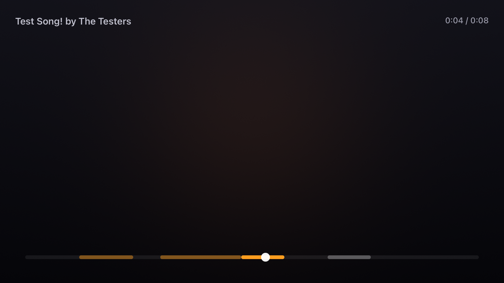

# LyricAdder for macOS

Write lyrics into Clone Hero / Moonscraper charts without hand-editing `lyric` events.
A native macOS port of [lyricAdder](https://github.com/DarkAngel2096/lyricAdder) by **DarkAngel2096**,
rebuilt in Swift with a Metal karaoke preview.



## Download

Get **LyricAdder-1.2.2.zip** from [Releases](../../releases). It's a universal app (Apple silicon + Intel),
needs macOS 14 or later, and is signed with Developer ID and notarized by Apple. Unzip it and open it.

## How to use it

1. Chart your song in Moonscraper. Place `phrase_start` / `phrase_end` events and an empty `lyric` event
   wherever a syllable is sung.
2. In LyricAdder, open the `.chart` (or `notes.mid`) on **Lyric Input**.
3. Type the lyrics, one phrase per line:
   ```
   First phrase on the first line
   Sec-ond phrase on sec-ond line
   And syl-lab-les get sep-a-rat-ed with dash-es
   ```
   Syllables are separated by spaces. A trailing `-` joins a syllable to the next one; a trailing `=` shows a
   literal hyphen. The gutter shows `syllables/lyric events` for each phrase and turns red when they don't match.
4. Click **Write new chart**. A timestamped backup of the untouched file is saved first.
   (For MIDI, the result is written as `lyricAdderOutput.mid` next to the original.)
5. **Lyric Preview** plays the song folder's audio (`song.ogg` and the other stems) with a karaoke wipe, so you can
   check the timing. It can also preview lyrics you haven't written to the file yet.

Settings and backups are stored in `~/Library/Application Support/LyricAdder/`.

## What changed from the original

The `.chart` output is byte-for-byte what lyricAdder 1.2.2 writes (it also keeps the file's BOM and final line
break). Along the way, these bugs were fixed:

* Preview timing used a fixed 192 ticks per beat; it now uses the chart's `Resolution`.
* Charts with Unix line endings can be read.
* MIDI: running status, note-off phrase ends, and lyrics longer than 127 bytes or with non-ASCII text are handled
  correctly. Only the lyric text is rewritten, so overdrive, percussion and text events in `PART VOCALS` are kept.
  `+` pitch-slide events aren't counted as syllables.
* Writing twice no longer overwrites the backup of the original file.

Tested with Moonscraper Chart Editor 1.5.13, in both directions. The full write-up is in
[docs/REVERSE_ENGINEERING.md](docs/REVERSE_ENGINEERING.md).

## Command line

The release also ships a CLI built from the same core:

```bash
lyricadder-cli info song/notes.chart
lyricadder-cli check song/notes.chart lyrics.txt
lyricadder-cli apply song/notes.chart lyrics.txt
lyricadder-cli render-frame song/notes.chart 12.5 frame.png --size 1920x1080 --scale 2
```

## Building

Requires Xcode 16 or later (Swift 6).

```bash
swift test
./scripts/build-app.sh                         # build/LyricAdder.app (ad-hoc signed)
SIGN_IDENTITY="Developer ID Application: …" ./scripts/build-app.sh
NOTARY_PROFILE=my-profile ./scripts/notarize.sh  # notarize, staple, zip
```

| Path | |
| --- | --- |
| `Sources/LyricCore` | file formats and logic (no UI) |
| `Sources/LyricRender` | Metal renderer, Core Text rasterizer, audio decoding and playback |
| `Sources/CStbVorbis` | stb_vorbis for `.ogg` playback |
| `Sources/LyricAdder` | SwiftUI / AppKit app |
| `Sources/lyricadder-cli` | command line tool |
| `scripts/parity_original.js` | runs the original JavaScript headlessly, to compare results |

## License

ISC. The original lyricAdder is © DarkAngel2096, and the port is © Avery Felts. stb_vorbis is public domain / MIT.
See [LICENSE](LICENSE) and [THIRD_PARTY_NOTICES.md](THIRD_PARTY_NOTICES.md).
